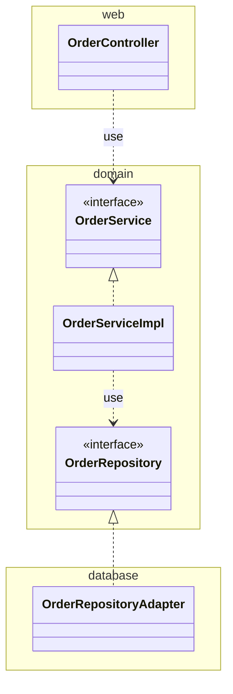

# ADR-0007: Package layout

## Context
Every service needs the same internal structure, so that any team member can find a class without knowing who wrote it, and so that the rules on dependencies can be checked automatically.

The course gives two indications that must be combined:

- package by feature (`holds/`, `orders/`, `catalog/`) is the course standard, while package by layer is the weaker choice, since every change to a feature touches distant packages;
- ports and adapters: the domain owns the interfaces it needs (ports), technology-specific implementations (adapters) live outside it, and dependencies point inwards.

## Decision
Each service is organised **by feature at the top level**, and **by ports and adapters inside each feature**:

- `web`: controllers (Kotlin) or handlers (Rust) and their DTOs. It depends on `domain`.
- `domain`: the service, the domain types and the ports, i.e. the interfaces of what the domain needs (repositories, publishers, clients of other services). It depends on nothing else in the service, and imports neither web nor persistence libraries.
- `database`: the adapters that implement the persistence ports (JPA in Kotlin, sqlx in Rust). It depends on `domain`.

Configuration (`config/`) and the error mapping (`errors/`) stay at the root of the service, next to the main class.

The diagram shows a Kotlin feature; in Rust the service is a plain struct, and only the ports are traits.



Example Kotlin:

```
it/polito/wa2/inventoryorders/
├── InventoryOrdersApplication.kt
├── config/
├── errors/
├── orders/
│   ├── web/        OrderController, DTOs
│   ├── domain/     OrderService, OrderServiceImpl, Order, OrderRepository (port)
│   └── database/   OrderRepositoryAdapter, OrderJpaRepository, OrderEntity
└── holds/
    ├── web/
    ├── domain/
    └── database/
```

Example Rust:

```
src/
├── main.rs
├── config.rs
├── error.rs
└── orders/
    ├── mod.rs
    ├── web.rs        handlers and DTOs
    ├── domain.rs     OrderService, Order, trait OrderRepository (port)
    └── database.rs   PgOrderRepository (adapter), OrderRow
```

## Rejected
- **Package by layer for the whole service** (`web/`, `domain/`, `database/` at the top). Every change to a feature would touch three distant packages.
- **One flat package per feature**. It works, but the layer of each class would be visible only from its name, and in Kotlin the ArchUnit rules would have to rely on naming conventions being respected.

## Consequences
- `+` A feature lives in one directory, and its persistence can be replaced or faked in tests without touching the domain.
- `+` The direction of dependencies is the same in every service and in both stacks.
- `-` In Kotlin, `internal` hides a class from other Gradle modules, not from other packages of the same module, so in a single-module service it does not enforce these rules. They are checked by ArchUnit tests instead.
- `-` More directories for small features.
- `-` In Rust, module privacy is enforced by the compiler, so what is not `pub` in `database` is invisible to `web`; the items needed for the wiring in `AppState` must stay visible inside the crate, and for them the rules are checked in review.