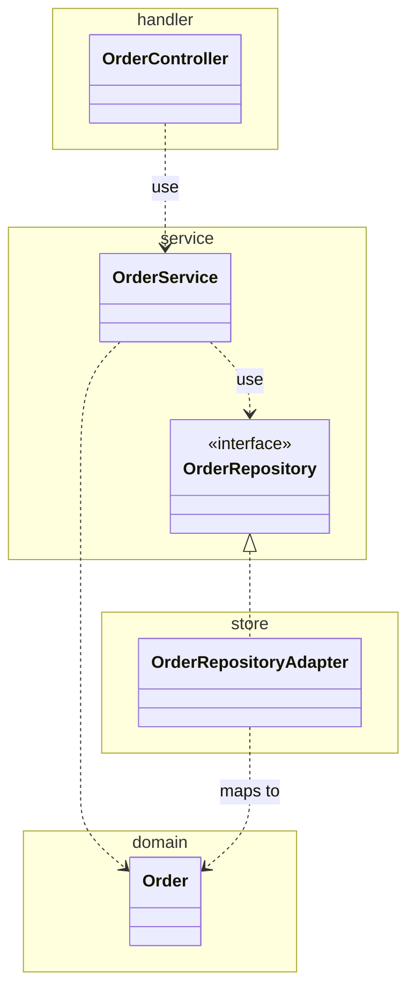
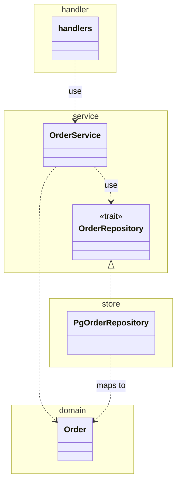

# ADR-0007: Package layout

## Context
Every service needs the same internal structure, so that anyone can find a class without knowing who wrote it, and so that the dependency rules can be checked automatically.

## Decision
Each service is organised **by feature**, with **one sub-package (Kotlin) or module (Rust) per layer** inside each feature:

- `handler`: HTTP entry points and DTOs. Depends on `service` and `domain`.
- `service`: use cases and ports (the interfaces the service needs). Depends on `domain`.
- `domain`: domain types. Depends on nothing.
- `store`: adapters that implement the ports with the database. Depends on `service` and `domain`.

Configuration, error mapping and types shared by several features stay at the root of the service.

The `orders` feature is used below as an example; every feature follows the same scheme.

### Kotlin

| Sub-package | Classes |
|---|---|
| `handler` | `OrderController`, and `OrderDtos.kt` with the request and response DTOs |
| `service` | `OrderService`, the port `OrderRepository` (one file per port) |
| `domain` | `Order` |
| `store` | `OrderRepositoryAdapter` (implements the port, maps `OrderEntity` to `Order`), `OrderJpaRepository`, `OrderEntity` |

```
it/polito/wa2/inventoryorders/
├── InventoryOrdersApplication.kt
├── config/
├── errors/
├── common/
└── orders/
    ├── handler/   OrderController.kt, OrderDtos.kt
    ├── service/   OrderService.kt, OrderRepository.kt
    ├── domain/    Order.kt
    └── store/     OrderRepositoryAdapter.kt, OrderJpaRepository.kt, OrderEntity.kt
```



### Rust

| Module | Contains |
|---|---|
| `handler.rs` | handlers and DTOs |
| `service.rs` | `OrderService` (struct), `trait OrderRepository` |
| `domain.rs` | `Order` |
| `store.rs` | `PgOrderRepository` (implements the port with sqlx), `OrderRow` |

```
src/
├── main.rs
├── config.rs
├── error.rs
└── orders/
    ├── mod.rs
    ├── handler.rs
    ├── service.rs
    ├── domain.rs
    └── store.rs
```



## Rejected
- **By layer for the whole service**: every change to a feature touches distant packages.
- **One flat package per feature**: in Kotlin the layer of a class would be visible only from its name, and rules could not be checked per package; in Rust it would mean a single file per feature, with no module boundary between layers.
- **An interface for every service**: a service has one implementation; only ports, which also have a test fake, are interfaces.

## Consequences
- `+` All the code of a feature lives in one directory, and the layer of each class is visible from its path (`orders/store/...`). Since the service depends only on the port, the store can be replaced by an in-memory fake in the service tests, without a database.
- `-` In Kotlin, `internal` makes a class visible to the whole Gradle module, i.e. the whole service, so it cannot stop a handler from using a store class. The dependency rules are checked by ArchUnit tests instead, which fail the build when, for example, a class in `..handler..` depends on one in `..store..`.
- `-` In Rust, what is not `pub` in a module is invisible to the others, so the compiler enforces most rules. The exception is what `main.rs` needs to build the `AppState` (e.g. `PgOrderRepository`): it must be visible in the whole crate, so a handler could use it too, and this case is checked in review.