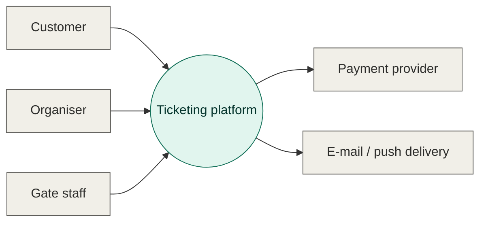
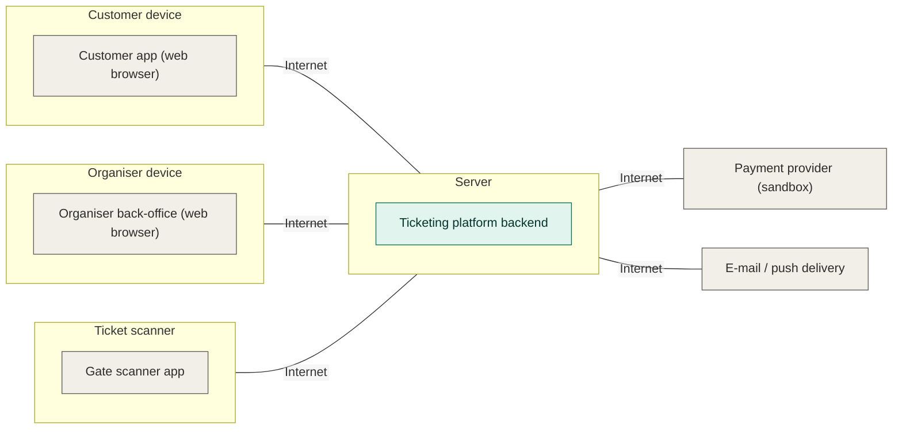
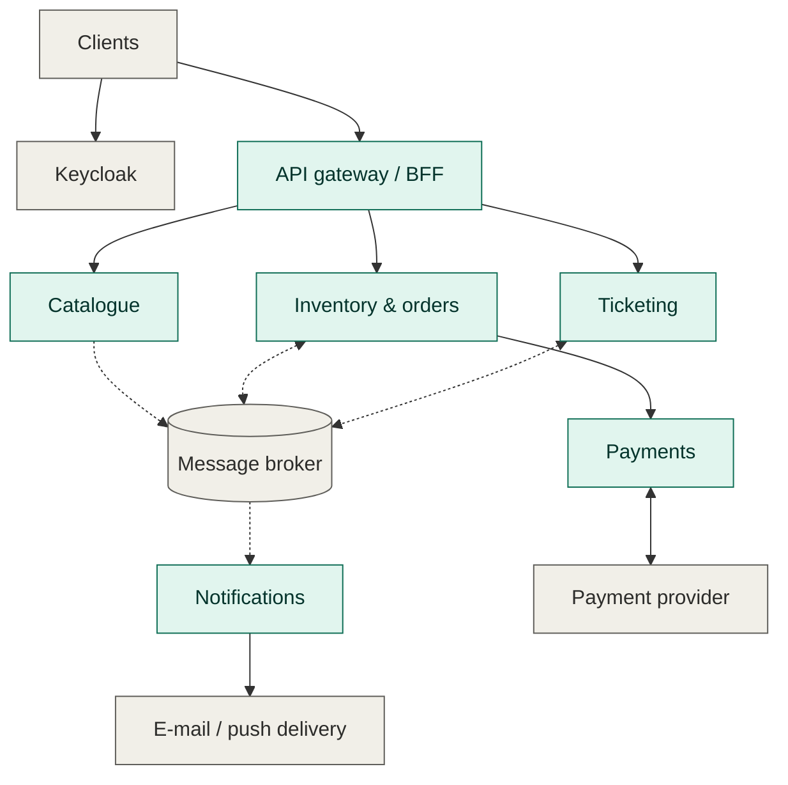

# M1 – Group 1

**Repository:** [polito-wa2-ticketing](https://github.com/devgfe/polito-wa2-ticketing)

## 1. Team

| Member | Student ID | GitHub |
|---|---|---|
| Gabriele Ferrero | s358479 | @devgfe |
| Luca Robustelli | s359863 | @LucaRobus99 |
| Francesco Nicolini | s361082 | @FrancescoNicolini000111 |
| Alessandro Proietti | s354038 | @AlessandroProietti |

## 2. Domain scope

### 2.1 Overall description

The platform sells tickets for events with reserved seating.

An organiser describes a venue through its seating plan, made of sectors, rows and seats. An event can take place in one or more sessions, each with its own date, time and set of seats. Within each session, the seats are grouped into price tiers. When the event is ready, the organiser publishes it with the time at which sales open. The organiser can then follow the sales on a dashboard.

Customers browse and search the catalogue of published events. Once sales are open, they choose up to four free seats on the seat map of a session and hold them while they complete the purchase. After the payment, the purchase becomes an order, and the customer receives one ticket for each seat. Customers can cancel an order within the refund window and get their money back. They are notified about their orders.

At the venue entrance, gate staff validate the tickets. A ticket can be presented more than once: scanning it again always gives the same result as the first scan.

In each session, every seat is always in exactly one of three states:

- **Free**: the seat is available and is shown as free on the seat map.
- **Held**: the seat is reserved for one customer for about ten minutes, while that customer completes the purchase.
- **Sold**: the seat is paid and a ticket has been issued for it.

A seat changes state only in these cases:

- **Free → Held**: a customer holds the seat. If several customers try at the same moment, only one of them gets it.
- **Held → Sold**: the customer completes the payment.
- **Held → Free**: the customer releases the hold, or about ten minutes pass without a payment. In the second case the platform frees the seat by itself, without any request.
- **Sold → Free**: the order is cancelled and refunded. The original order and payment are not deleted: the refund is recorded as a new operation.

No other change is possible. For example, a free seat cannot become sold without being held first.

**Business rules.** Two rules hold for the whole platform, even when many customers act at the same time:

1. The same seat is never sold twice.
2. No money is lost: every recorded payment corresponds to one valid order, and vice versa.

Sales open at a published time, so many customers arrive together. Within seconds, traffic can reach about a hundred times its usual level.

Some tasks are handled by external systems: user accounts and login (Keycloak), payments (a payment provider, in sandbox mode), and the actual delivery of e-mails and push messages.

### 2.2 Stakeholders

| Stakeholder name | Description |
| :--------------: | :---------- |
| Customer | Person who buys tickets for events. |
| Organiser | Person who publishes events and follows their sales. |
| Gate staff | Person who validates tickets at the venue entrance. |
| Keycloak | External identity provider: user accounts, login and roles. |
| Payment provider | External system that authorises, captures and refunds payments. |
| E-mail / push delivery | External service that delivers the e-mails and push messages sent by the platform. |

### 2.3 Context diagram and interfaces

#### Context diagram

#### Interfaces

| Actor | Physical interface | Logical interface |
| :---: | :----------------- | :---------------- |
| Customer | Device with a web browser, Internet | Customer app (web GUI) |
| Organiser | Device with a web browser, Internet | Organiser back-office (web GUI) |
| Gate staff | Ticket scanner at the entrance, Internet | Gate scanner app (GUI) |
| Payment provider | Internet | Payment provider API (sandbox) and payment notifications (webhooks) |
| E-mail / push delivery | Internet | E-mail / push delivery API |

### 2.4 Functional and non-functional requirements

#### Functional requirements

| ID | Name | Description |
| :--- | :--- | :--- |
| FR1 | Manage catalogue | |
| FR1.1 | | Create and update venues, each with a seating plan (sectors, rows, seats) |
| FR1.2 | | Create and update events, each with one or more sessions (date and time) and a sales opening time |
| FR1.3 | | Define price tiers and assign each one to a set of seats of a session |
| FR1.4 | | Publish an event |
| FR2 | Browse catalogue | |
| FR2.1 | | List the published events |
| FR2.2 | | Search the published events by text |
| FR2.3 | | Show the details of an event (venue, sessions) |
| FR3 | Hold seats | |
| FR3.1 | | Show the seat map of a session, with the price tier and the state (free, held, sold) of each seat |
| FR3.2 | | Update the seat map live when seats are held, sold or released |
| FR3.3 | | Hold from one to four free seats of a session at a time, once sales are open |
| FR3.4 | | Hold each seat of a session for only one customer at a time |
| FR3.5 | | Keep held seats reserved for about 10 minutes and show when the hold expires |
| FR3.6 | | Release a hold when the customer asks, or automatically when it expires |
| FR4 | Buy tickets | |
| FR4.1 | | Pay for the held seats through the payment provider |
| FR4.2 | | Record the purchase as an order, linked to its payment |
| FR4.3 | | Mark the seats of a paid order as sold |
| FR4.4 | | Issue one ticket for each seat of a paid order |
| FR4.5 | | Send the order confirmation and the tickets to the customer (e-mail or push message) |
| FR4.6 | | Show the customer the state of an order |
| FR5 | Cancel orders | |
| FR5.1 | | Cancel an order within the refund window |
| FR5.2 | | Refund the payment of a cancelled order through the payment provider |
| FR5.3 | | Make the seats of a cancelled order free again |
| FR5.4 | | Invalidate the tickets of a cancelled order |
| FR5.5 | | Keep cancelled orders and refunds in the history |
| FR5.6 | | Notify the customer of the cancellation and refund |
| FR6 | Validate tickets | |
| FR6.1 | | Validate a ticket at the venue entrance |
| FR6.2 | | Record every scan of a ticket |
| FR6.3 | | Give the result of the first scan when the same ticket is scanned again |
| FR7 | Show sales dashboard | |
| FR7.1 | | Show the organiser the sales of their events |
| FR7.2 | | Show the sales totals of each session |
| FR8 | Manage access | |
| FR8.1 | | Log in and log out through Keycloak |
| FR8.2 | | Allow each user only the functions of their role (see Table of rights) |

#### Non-functional requirements

| ID | Type | Description | Refers to |
| :---: | :---: | :--- | :--- |
| NFR1 | Correctness | The same seat is never sold twice, even when many customers try to buy it at the same time | FR3, FR4 |
| NFR2 | Correctness | Every recorded payment corresponds to one valid order, and every valid order to one payment | FR4, FR5 |
| NFR3 | Reliability | A purchase request sent again (e.g. after a network error) creates no second order and no second charge | FR4 |
| NFR4 | Reliability | Purchases and refunds stay correct even if the payment provider is slow, unavailable, or reports results asynchronously or out of order | FR4, FR5 |
| NFR5 | Efficiency | Ticket validation at the entrance is fast | FR6 |
| NFR6 | Scalability | When sales open, traffic can reach about 100 times the usual level within seconds: the platform serves it or refuses the excess in a controlled way | FR3, FR4 |
| NFR7 | Security | Customers can see only their own holds, orders and tickets; organisers can change only their own events | FR1, FR3, FR4, FR5, FR7 |
| NFR8 | Portability | The whole platform starts with one command (docker compose up) from a clean copy of the repository | All FR |

### 2.5 Table of rights

| Actor | FR1 | FR2 | FR3 | FR4 | FR5 | FR6 | FR7 | FR8 |
| :---: | :---: | :---: | :---: | :---: | :---: | :---: | :---: | :---: |
| Customer | | X | X | X | X | | | X |
| Organiser | X | | | | | | X | X |
| Gate staff | | | | | | X | | X |
| Payment provider | | | | | | | | |
| E-mail / push delivery | | | | | | | | |

### 2.6 Use cases

#### Use case brief

| UC name | Goal | Description |
| :--- | :--- | :--- |
| UC1 Manage catalogue | Put an event on sale | The organiser creates a venue with its seating plan and an event with its sessions and price tiers, sets the sales opening time and publishes the event. |
| UC2 Browse catalogue | Find an event | The customer lists or searches the published events and opens the details of one of them. |
| UC3 Hold seats | Reserve seats while buying | Once sales are open, the customer picks up to four free seats on the live seat map and holds them for about ten minutes. The customer can release the hold; otherwise it expires on its own. |
| UC4 Buy tickets | Turn held seats into tickets | The customer pays for the held seats through the payment provider. The platform records the order, marks the seats as sold, issues one ticket per seat and sends the tickets to the customer. |
| UC5 Cancel order | Get a refund | Within the refund window, the customer cancels an order. The payment is refunded, the seats become free again and the customer is notified. |
| UC6 Validate ticket | Let ticket holders in | Gate staff scan a ticket at the entrance and get the result. Scanning the same ticket again gives the result of the first scan. |
| UC7 Monitor sales | Follow the sales of an event | The organiser looks at the sales dashboard, with the totals of each session. |
| UC8 Log in / log out | Access the platform | Every user logs in and out through Keycloak and can use only the functions of their role. |

### 2.7 Hardware/software architecture

## 3. Proposed services

We adopt the decomposition suggested by the course:

- **API gateway / BFF**: The single entry point of the platform: the customer app, the organiser back-office and the gate scanner talk only to it, and it forwards each request to the right service after a first check of the user's identity.
- **Catalogue**: Holds what is on sale: organisers use it to publish venues, events, sessions and prices, while customers browse and search it.
- **Inventory & orders**: The heart of the purchase: it shows which seats are free, reserves them for about ten minutes while the customer pays, and turns the reservation into an order. Seats and orders live in the same service because they must always change together.
- **Payments**: Handles the money: it charges the customer through the external payment provider and refunds cancelled orders.
- **Ticketing**: Issues a ticket for every seat of a paid order and validates tickets at the entrance.
- **Notifications**: Sends customers their tickets and other updates by e-mail or push message.

## 4. Stack assignment

| Service | Stack |
|---|---|
| API gateway / BFF | Kotlin + Spring Boot |
| Catalogue | Rust + Axum |
| Inventory & orders | Kotlin + Spring Boot |
| Payments | Kotlin + Spring Boot |
| Ticketing | Rust + Axum |
| Notifications | Kotlin + Spring Boot |
