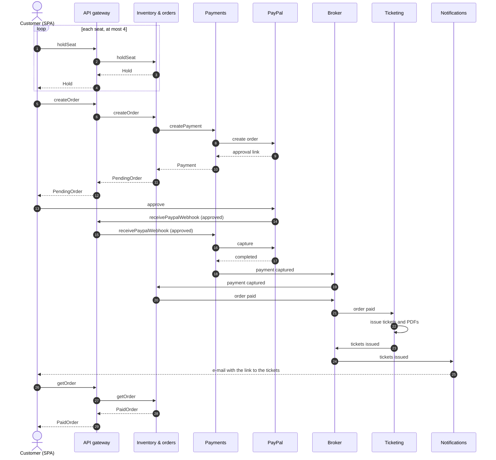

# M2 – Group 1

## 1. OpenAPI

| Service | Document | Exposed through |
|---|---|---|
| Catalogue | [catalogue/openapi.yaml](../../services/catalogue/openapi.yaml) | API gateway |
| Inventory & orders | [inventory-orders/openapi.yaml](../../services/inventory-orders/openapi.yaml) | API gateway |
| Payments | [payments/openapi.yaml](../../services/payments/openapi.yaml) | Internal; only the PayPal webhook through the API gateway |
| Ticketing | [ticketing/openapi.yaml](../../services/ticketing/openapi.yaml) | API gateway |
| Notifications | none | No HTTP API: it only consumes broker messages |
| API gateway | none | It routes the APIs above |

## 2. Data ownership

Each service owns its schema; no other service reads or writes it. Copies are read-only and are updated only by broker messages.

| Data | Owner | Read-only copies | Copies updated by |
|---|---|---|---|
| Venues, sectors, seats | Catalogue | Inventory & orders, Ticketing | venue created, venue updated, venue deleted |
| Events, sessions, price tiers | Catalogue | Inventory & orders, Ticketing | event published, event updated, session created, session updated, price tier updated |
| Seat states | Inventory & orders | none | |
| Orders | Inventory & orders | Ticketing | order paid, order cancelled |
| Payments and refunds | Payments | none | |
| Tickets, scans, PDFs | Ticketing | none | |
| Users and roles | Keycloak | none (services store only user ids) | |

Notifications has no schema.

### Messages

| Message | Producer | Consumers |
|---|---|---|
| venue created, venue updated, venue deleted | Catalogue | Inventory & orders, Ticketing |
| event published, event updated, session created, session updated, price tier updated | Catalogue | Inventory & orders, Ticketing |
| payment captured, payment failed | Payments | Inventory & orders |
| order paid | Inventory & orders | Ticketing |
| order cancelled | Inventory & orders | Payments, Ticketing, Notifications |
| tickets issued | Ticketing | Notifications |

## 3. Purchase flow

